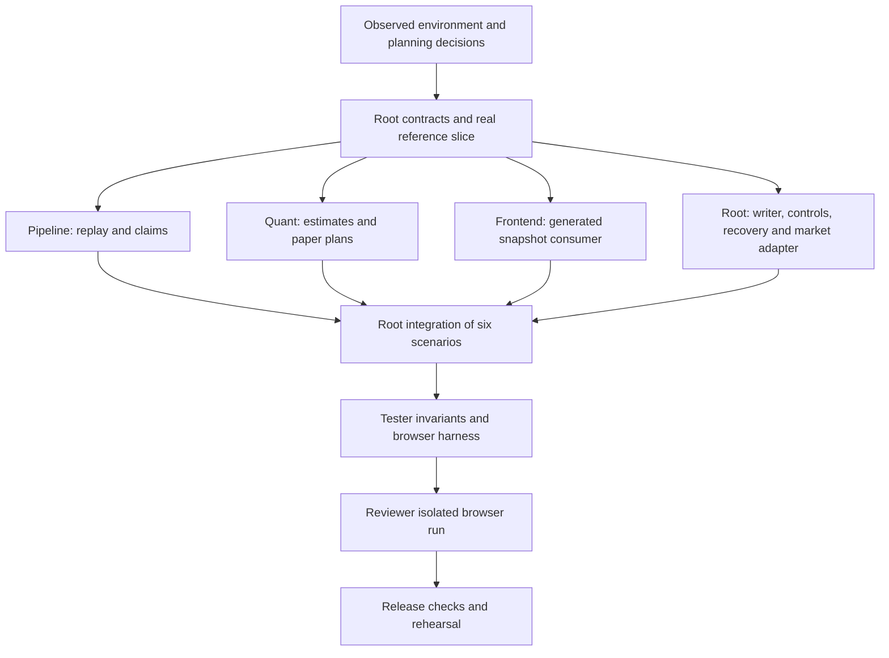

# Leonida Alpha: repository-specific implementation plan

## Current G3 outcome - 15 November 2026

G3 is complete and accepted; stop before G4. [G3_HANDOFF.md](G3_HANDOFF.md) and [STATE.md](STATE.md) supersede the historical G2 status/stop statements below. The actual primary input is now the verified supplied t1/t2/t3 cache, not generated test media. All629 observations remain abstained and cannot generate an estimate or trade.

Implemented: schema2/g3-v1 execution/group/trace contracts; deterministic event-time source/quote/deadline scheduling; six source statuses; narrative routing and candidates; synthetic-only risk/depth/fee/latency/entry/exit accounting; atomic SQLite audit and recovery; isolated scenario/reset commands; full REST/WS projections and receipts; frontend scenario controls, tape, positions, marks and execution-stage inspection. Bounded source batches use128 entries. Quotes and publication do not become new source evidence.

The separate authored courtroom fixture raises a50% synthetic anchor to about54.48%, fills6/10 requested contracts and demonstrates partial/final exits. Other fixtures exercise unsupported routes, disagreement, duplicate delivery and stale/adverse-price cancellation. Synthetic selection creates a new run rather than mixing annotations into the recordings. Recorded runs remain candidate-only, and actual GTA VI quotes remain separate context. Synthetic accounting seeks forward; reset starts a new epoch. This deliberate seek policy preserves committed fills.

Nine focused G3 tests, six isolated scenario HTTP/WS inspections, actual recording and G1 smoke checks, frontend build and integrated Edge browser checks passed. After the interrupted session, valid backend/frontend files were inspected and preserved; only missing checks/command support and two frontend validation/freshness gaps were completed. Full formal G4 coverage/reviewer work, automatic scenes/diarization, live Twitch ingestion, actual fee/depth integration and calibration remain future work.

The following sections preserve the earlier G2 baseline design and its historical findings; current implementation details and acceptance are in the G3 handoff above.

Revised 15 November 2026 after G2 implementation and generated-recording verification. This revision supersedes the synthetic-primary input choice below the original PLAN.md; ownership and corrected mathematical rules remain in force. Read alongside [STATE.md](STATE.md), [DECISIONS.md](DECISIONS.md) and [TASKS.md](TASKS.md).

## 1. Starting point and delivery boundary

At the initial inspection, `C:\Users\abdul\Desktop\drhck` contained 31 handoff files and no Git repository or application. G1 is now implemented in root-owned core/scripts with locked dependencies, a visible state viewer and generated wire types. See [G1_HANDOFF.md](G1_HANDOFF.md) for the exact implemented subset; the remaining modules below are the future build design. G2 includes the React terminal and actual offline media providers; the formal tester-owned G4 suite remains future work.

Retain the useful assets: reference Pydantic contracts and envelope, three configuration files, five custom roles, seven prompts, the validator and capture script. The capture `data/snapshots/kalshi_actual_20261114T205727Z.json` contains five event families, 72 distinct markets, all eight registry aliases and no recorded capture errors. It is historical reference, not current liquidity. It has Yes top sizes but no No sizes, depth or fee schedule.

The primary demo input is 2–6 locally supplied screen recordings of Twitch GTA V streams, with the chat panel visible inside each recording. Preprocess sampled frames with chat-region OCR and cache the resulting evidence for repeatable, no-key playback. GTA V is proxy demo material, not observed GTA VI gameplay or predictive validation. Keep the six synthetic scenarios as deterministic regression/fallback inputs. The desk remains local and paper-only; playback works without credentials/internet after dependencies and evidence caches exist.

G1 proved a single supplied fixture through visible calculated state. G2 now decodes and transcribes actual generated test recordings because no user footage was supplied. Recording offsets, cache integrity and synchronized playback are implemented. This implementation turn stops after G2; full broker scheduling, native live Twitch ingestion, automatic scenes and real venue fee/depth integration remain later work.

## G2 implementation outcome and revised acceptance

The latest user request makes local recordings, sampled chat OCR, audio extraction/transcription and caching primary. All three directly supervised workers delivered their owned paths without delegating. Root integrated their APIs and transport; [G2_HANDOFF.md](G2_HANDOFF.md) records actual acceptance.

The input gate accepts generated media when no user recording exists, as explicitly requested. Two 12-second generated videos passed actual FFmpeg/RapidOCR/local Whisper, offsets, cache integrity/reuse and browser playback. This proves pipeline function, not accuracy on real Twitch overlays. The intended demo remains 2-6 supplied GTA V recordings under `data/recordings/inbox/` with `data/recordings/manifest.json`.

Audio is part of P2: PCM/activity plus local timestamped ASR, with missing-model/tool reasons and no runtime download. Speaker attribution defaults to unknown; automatic diarization is out of scope. Conservative English lexical semantics are implemented; general semantic extraction remains a gap.

Root persists cursor/commands/snapshots through one SQLite writer and restarts paused. Additive schema-2 revision `g2-v1` covers warmup, media provenance and playback. Paper plans can commit/restore atomically through root storage, but the visible app remains candidate-only. Full execution scheduling/tape and broader G3/G4 integration are not claimed.

## 2. Initial preflight and retained stack

The table records the original pre-install environment; current locked versions and verification are in STATE/G1_HANDOFF. Playwright with installed Microsoft Edge has since been exercised successfully for G1 browser checks.

| Inspected capability | Result and implementation consequence |
|---|---|
| Python / SQLite | Python 3.12.6; SQLite 3.45.3. Use Python 3.12, stdlib SQLite and one writer. |
| Python packages | Pydantic 2.10.6, HTTPX 0.28.1, pytest 9.0.2 installed globally; FastAPI/Uvicorn absent. Global installs are observations, not an application environment. |
| Python manager | uv 0.11.21 available. Root creates `pyproject.toml`, `uv.lock` and `.venv`; use locked `uv sync` thereafter. |
| JavaScript | Node 22.17.1 and npm 10.9.2 available. Use npm only; `npm.cmd` avoids PowerShell script execution-policy ambiguity. |
| Other managers/tools | pnpm, Yarn, Bun, make and FFmpeg did not resolve on PATH. Git 2.51.2 exists, but this directory is not a repository. |
| Browser | No browser/Playwright/CDP tool in the session catalog. Reviewer found Chrome/Edge and Selenium 4.34.2, but no demonstrated driver session. |
| Services/media | No observed live market request, recording decode, transcription, chat connection or A/V route in this planning task. Credentials were not needed or inspected. |

Select FastAPI, Uvicorn, Pydantic v2, HTTPX and SQLite for the backend; React, TypeScript and Vite for the UI. Root resolves compatible Python dependencies once at G1 and locks them, initially keeping Pydantic 2.10.6 for reproducible adoption. Frontend resolves and locks its packages at G2. Installed Node meets Vite's documented 22.12+ branch requirement; template-specific compatibility must still pass the actual install/build. [Vite getting started](https://vite.dev/guide/)

Use a root npm manifest/lockfile for `json-schema-to-typescript` generation tooling; frontend owns its separate `frontend/package.json` and `frontend/package-lock.json`. These are two dependency scopes using one JavaScript package manager. Root owns Python test dependencies, generated TypeScript and scripts; only tester creates test source. Do not introduce Redis, Kafka, a vector store, Docker or a second frontend framework.

Codex preflight: installed `codex-cli 0.169.0-alpha.11.1`; help advertises `--strict-config`, but `codex --strict-config features list` rejects that combination. The supported feature-list command accepted explicit agent-setting overrides. This is not full strict project-config validation. Two custom roles, `quant_engineer` and `qa_reviewer`, actually spawned, performed read-only work and returned in this session.

Official documentation supports standalone `.codex/agents/*.toml` with name/description/instructions, inherited permissions, and `[agents] enabled` plus `max_concurrent_threads_per_session` excluding root. Keep the existing cap of three and parent model inheritance. Do not add `max_depth`; it was not found in the current reference. Worker non-delegation remains an instruction, not a separate sandbox. [Subagents](https://learn.chatgpt.com/docs/agent-configuration/subagents), [configuration reference](https://learn.chatgpt.com/docs/config-file/config-reference)

No project or user Codex configuration needs changing for this plan. A feature flag mentioning browser capability does not establish a callable browser tool. Existing connected tools do not supply a demonstrated Twitch media route; no MCP is required by the application.

## 3. Concrete modules and dependency direction

`backend/core/schemas.py` becomes the canonical runtime contract module; service protocols live in `backend/core/interfaces.py`. Every worker imports those contracts. Core runtime imports worker implementations only at composition, while worker modules never import `backend/main.py` or instantiate persistence.

| Owner | Module/path to create | Responsibility |
|---|---|---|
| Root | `backend/core/schemas.py`, `interfaces.py`, `config.py` | Validated wire DTOs, immutable settings, shared protocols/results. |
| Root | `backend/core/clock.py`, `identity.py` | Simulation/live clocks, canonical hashes, run-scoped identities. |
| Root | `backend/core/storage.py`, `migrations/`, `runtime.py` | Single SQLite writer, serialized per-run commands/events, transactional recovery. |
| Root | `backend/core/market.py`, `projector.py`, `receipts.py` | Captured definitions/optional public reads, immutable snapshots, trace lookup. |
| Root | `backend/core/reference_slice.py`, `config/foundation_scenario.json`, `scripts/state_viewer.html` | G1-only deterministic reference implementations and visible state proof; no worker-owned files needed. |
| Root | `backend/main.py`, `scripts/`, `contracts/`, `frontend/src/generated/` | Lifespan/routes, launch/check/export tools, schemas/examples/generated types. |
| Pipeline | `backend/ingestion/replay.py`, `backend/perception/fixture.py`, `claims.py`, `scenes.py` | Replay transport, explicitly labelled supplied claims, support validation, grouping. |
| Pipeline | `data/scenarios/`, `data/recordings/` manifests | Versioned six-source fixtures and optional authorized-source manifests. |
| Quant | `backend/quant/normalization.py`, `features.py`, `routing.py`, `estimator.py`, `constraints.py` | Baselines, active evidence view, routes, bounded correction, coherence gates. |
| Quant | `backend/execution/fees.py`, `risk.py`, `broker.py`, `portfolio.py` | Pure execution plans, reservations, depth consumption, fees, positions/marks. |
| Frontend | `frontend/src/transport/`, `components/`, `App.tsx`, styles and frontend manifests | One decoder/store, terminal panels, replay controls and receipts. |
| Tester | `tests/contracts/`, `tests/quant/`, `tests/execution/`, `tests/integration/`, `tests/browser/`, `tests/fixtures/` | Invariant and integration/browser source; isolated DBs and run IDs. |

Dependency DAG:



The following signatures preserve the broader target design; implemented G2 interfaces are frozen in G2_CONTRACTS.md and worker handoffs. Do not assume every originally proposed group/scheduler DTO exists. Root owns shared wire models and generated types.

```python
# backend/core/clock.py and interfaces.py
Clock.now() -> datetime                         # aware run/domain time
ReplayClock.advance_to(at: datetime) -> None   # monotonic, root scheduler only
ReplaySource.events(context: RunContext) -> AsyncIterator[ReplayEvent]
Extractor.extract(window: SourceWindow) -> list[EvidenceClaim]
Grouper.upsert(claims: Sequence[EvidenceClaim]) -> list[EvidenceGroup]
FeatureEngine.ingest(delta: EvidenceViewDelta) -> IngestOutcome
FeatureEngine.rebuild(view: EvidenceView) -> None
FeatureEngine.snapshot(game_id: str, as_of: datetime) -> list[FeatureSnapshot]
Router.relevance(aspect: Aspect, market: MarketDefinition) -> RelevanceResult
Estimator.estimate(market: MarketDefinition, quote: MarketQuote | None,
                   features: Sequence[FeatureSnapshot], as_of: datetime) -> EstimateResult
FeeAdapter.quote(request: FeeRequest) -> FeeQuote
Risk.evaluate(estimate: EstimateResult, quote: MarketQuote | None,
              portfolio: PortfolioView, quantity: Decimal, as_of: datetime) -> PaperDecision
PaperBroker.plan(decision: PaperDecision, quote: MarketQuote,
                 portfolio: PortfolioView, liquidity: LiquidityView,
                 as_of: datetime) -> ExecutionPlan
Portfolio.mark(positions: Sequence[Position], quotes: Sequence[MarketQuote],
               as_of: datetime) -> PortfolioMark
Writer.commit(batch: WriteBatch) -> CommitResult                  # async
Runtime.create_run(request: CreateRunRequest) -> RunCreated        # async
Runtime.control(run_id: str, request: RunCommand) -> CommandResult # async
Runtime.inject(run_id: str, request: InjectRequest) -> CommandResult # async
StateProjector.snapshot(run_id: str) -> StreamEnvelope
ReceiptService.get(run_id: str, receipt_id: str) -> ReceiptDetail
```

`ReplayEvent` is a discriminated union of source-window, quote, source-status and deterministic clock/control events, with `event_id`, `available_at` and scenario version. A source event's fixture claims travel as labelled extraction input, not model-produced text. `RunContext` provides run identity/config/clock, not DB access. `EvidenceViewDelta` carries claim and group revisions/removals together; `EvidenceView` contains all active claims and group membership at its revision. Root passes Grouper output through this boundary, including group-only corrections; quant never infers hidden grouping state. `IngestOutcome` distinguishes new, duplicate, superseded and rejected. `ExecutionPlan` contains typed order/fill/reservation/ledger/liquidity changes plus expected portfolio revision. It may create a pending reservation before eligibility or resolve that reservation at eligibility. Root commits it once; quant cannot write the database. Planning a fill must not mutate authoritative state before commit.

## 4. Contract changes required before freeze

The reference calls itself schema 1 but is not a frozen application contract. Archive its models/example/schema under `contracts/reference-v1/` at G1, adopt runtime `schema_version="2"`, and make `contracts/models.py` a compatibility re-export of core. Rework the pack validator for its documented reference scope; create the runtime exporter separately. Root emits serialization-mode JSON Schema, OpenAPI, complete examples and TypeScript from the pinned environment. Decimal output must be strings in both JSON and TypeScript, not the permissive numeric input union. Generated artifacts identify schema/generator versions and are checked for drift.

| Boundary | Concrete adoption decision |
|---|---|
| Market identity | Add `market_id`, `market_namespace: venue|synthetic`, `venue_ticker: str|null`, `reference_venue_ticker: str|null`, `scenario_id: str|null`. Join all quotes/estimates/orders by market_id. Venue ID = `kalshi:<returned-ticker>`; replay ID = `synthetic:<scenario-version>:<alias>`. A synthetic market may reference captured rules but never uses a venue ticker as its executable identity. |
| Definition semantics | Add source/hash/capture time, definition mode, tick/quantity step with provenance, threshold operator/unit, and `outcome_group_complete`. Preserve actual rule text; the captured “above 96” contract's subtitle is 97, not evidence of a >=96 threshold. Unknown ticks/rules block venue execution. |
| Missingness | Typed reason codes and per-field reasons for null quote/feature measurements; `DepthBook.status=unknown|known_empty|known`, levels and `liquidity_event_id`. Require reasons for unavailable modalities. Known empty depth has no fills; unknown depth is not inferred as unlimited. |
| Source/claims | Nonempty stable IDs; source revision/hash, received/available timestamps and offsets; supporting quotation spans; extractor/model/prompt versions; active revision/supersession; dependency IDs. Validate quotation and time support against its source window. |
| Feature view | Add `evidence_view_id`, ordered claim-revision references, group IDs, baseline status (`warming_up|ready|seeded_fixture|unavailable`), age/missingness and effective-source diagnostic. Rename misleading `independent_group_count` to `dependency_group_count`. |
| Estimate abstention | `EstimateResult` always has result ID, market ID, as-of time and reason codes; either a ModelEstimate or an explicit abstention. Decisions reference result ID even when no estimate exists. No fabricated anchor for missing/wide/closed/endpoint quotes. |
| Orders and cash | Positive order/fill quantity, eligible time, requested/filled/remaining quantity, intent ID, risk-policy version, fee source/version, reservations and deterministic revision. A zero-quantity blocked decision is permitted, not a zero-quantity fill. |
| Position/mark | Remaining cost basis and entry fees, mark quote/time, marked quantity, unpriced quantity, liquidation VWAP/value, exit-fee estimate and reason. Total equity/P&L is null when material inventory is unpriced; expose priced subtotal separately. |
| UI/run controls | `RunStatus`, simulation time/speed, source modality availability, quote age, execution eligibility, control acknowledgement, warnings and metrics. Include bounded windows/groups or complete receipt references. Reset returns a new run ID. |
| Receipt detail | Immutable source spans/offsets, claim revisions, grouping/dependency rationale, feature/baseline diagnostics, nonnegative route, rule/model/config versions, coefficient contributions, decision and fill quote IDs, fee/depth/risk explanation. |

At the root ingestion/commit boundary enforce same-run references, resolvable IDs, unique reference lists, finite values, consistent warmup/z and stale-mode flags, limits/ticks, and estimate arithmetic. Model validators alone do not establish cross-record economic correctness. Preserve original inputs as append-only history; active revisions select the current interpretation.

Review probes found that the present reference accepts empty claim IDs, duplicate feature references, reasonless null measurements, contradictory stale/baseline states and inconsistent estimate arithmetic. The example also omits definitions/source statuses referenced by its claims/quotes. Repair these before publishing the G1 examples. Saved schema versus installed Pydantic differs at 27 Decimal-string pattern entries; lock and regenerate deliberately.

## 5. Evidence, mathematics and deterministic time

Use stable 10-second buckets, keyed by run/game/stream/aspect/modality/baseline version. Exactly one baseline observation exists per `(run, game, stream, aspect, modality, bucket, baseline_version)`, even if the bucket crosses scenes; retain individual scene detail for receipts/grouping separately. Combine attributable claims before that one update. Do not let chat volume move speech baselines. Use alpha `1-exp(-10/180)` for the regular-window MVP, explicitly skipping missing/abstained buckets. Warmup requires 20 valid buckets unless the fixture declares a seeded mean/variance/count and version.

For each unique valid bucket, calculate z from previous mean/variance with std floor 0.10 and clipping at +/-4, then apply the PLAN.md EWMA mean/variance equations. A positive z can coexist with negative absolute sentiment. Revisions replace interpretations; rebuild affected baseline history deterministically in availability order, with event time and stable ID tie-breakers. Revision processing never adds a second independent observation or retrospectively changes an already committed fill.

Maintain one capped contribution per underlying source bundle and per-stream scene/aspect bucket. Equal streamer caps are the starting point; extraction/attribution quality and explicit dependency discounts reduce weight once. Relevance is in [0,1], never a sign. Collapse rebroadcasts to their original dependency group. Speech/chat/visual cues for one moment share a bundle cap. Singletons stay visible with limited corroboration. `N_eff` measures concentration only; no sqrt(N), viewer-count reliability or face approval.

Resolve the ageing and relevance ambiguities explicitly: for each aspect feature let non-recency source weights w exclude route relevance, and `d=2^(-age/H)`. Display the decayed mean `M=sum(w*d*x)/sum(w*d)` and separate freshness `F=sum(w*d)/sum(w)`. For aspect-to-market relevance r use `X=r*M*F` once; skip r=0. This preserves lower route strength and makes singleton influence decay. Putting either a common relevance or decay only inside a normalized mean would cancel it. Claim eligibility/attribution is established before aggregation; this MVP uses one explicit r per aspect/market. When all measurements are unavailable, X is null and the feature is omitted with a reason, never replaced with neutral evidence. Initial heuristic half-lives: sentiment/surprise 300 seconds, defect severity 3600 seconds within the same build/platform; explicit supersession invalidates obsolete incidents. No unsupported maturity adjustment: multiplier stays 1.

Age, ordering, quote freshness, latency, cooldown and exits use run time. `available_at <= as_of` is mandatory; future source offsets confer no availability. Replay speed changes pacing only. At 1x and 5x the event order and outputs match after normalizing run/intent IDs; source/content IDs remain identical. Wall time is used for publication cadence/connection display, not model input. A mixed live-quote experiment, if later authorized, uses wall-clock quote freshness independent of paused evidence replay.

Use the existing heuristic coefficients and correction cap 0.5. Reference p is the valid active Yes midpoint, with initial max spread USD 0.05, no stale reference and no endpoint fixing. Correction is recomputed from the active evidence view: `A=clip(sum(beta*X), -0.5, 0.5)` and `p_model=sigmoid(logit(p_market)+A)`. An absent coefficient is unsupported routing; no attributable configured inputs means abstention. The numeric logit epsilon does not make a closed or endpoint quote eligible. UI says “Scenario estimate — uncalibrated”; no Bayesian posterior/confidence-interval claim.

Quote-only changes refresh anchor/EV/marks; at the same evidence as-of time correction remains unchanged. A timer can project state or advance a specified simulation ageing tick; it never ingests evidence or retries an entry as new. Decision revisions are keyed to causal evidence/quote/control changes, not UI publish count. No automatic technical-quality route to online release dates. Bug severity is nonnegative with a negative coefficient; negative sentiment is not negated again.

Only explicitly configured aliases produce estimates. Display unsupported markets with their reason. For comparable thresholds, suppress contradictory estimates instead of silently adjusting them; validate actual operators/units and order. Treat an awards selection as one GTA-versus-not-GTA binary unless the complete outcome group and rules are known. Do not present independent nominee adjustments as a coherent full distribution.

## 6. Paper execution decisions

Preserve bankroll USD 10,000, all-in order/game/total cost caps 0.5%/3%/5%, minimum net EV USD 0.03, 60-second entry cooldown and 10-second maximum quote age. Add fixed requested quantity 10 contracts, synthetic quantity step 1, 250ms simulated processing latency and `simulation-linear-v1` fee schedule. That schedule charges `ceil_to_cent(0.01 * executed_quantity)` once per marketable order sweep; it is an illustrative scenario fee, never a Kalshi fee assertion. Empty fills incur no fee. Use Decimal throughout money, quantities, fee rounding and ledger arithmetic; convert model float probabilities explicitly through their decimal string representation.

Choose side-specific executable ask VWAP for the fillable quantity, then subtract total fee/quantity from its fair-side value. Do not add spread again. Recompute risk/EV/fee when depth reduces quantity; block if the resulting order fails gates. Fixed size is a requested ceiling, constrained by cash, pending reservations, game exposure and available depth. No opposing Yes/No positions, repeated entry into an existing position, default Kelly or maker-fill model.

Risk reserves cash and exposure before execution. At `eligible_at`, recompute the market-relative estimate and net entry EV from the latest available quote and evidence, then recheck active status, mode, age, original limit, reservation ceiling, costs and depth. Preserve both decision-time and eligibility-time inputs in the receipt. Risk/time exits use held-side bids and their own cost/mode/freshness gates; they are not blocked by entry EV thresholds or entry cooldown. Fill only synthetic-evidence/synthetic-quote runs by default. Cached-stale quotes never admit new normal fills. Recorded/synthetic evidence with live quotes remains visibly candidate-only. Unknown fees or depth block execution.

Consume book liquidity by `(run_id, market_id, liquidity_event_id, outcome_side, book_side, level)`, where book_side is bid or ask; entry must not consume exit liquidity. Repeat quote publication or a new wrapper quote ID must not replenish a book. Synthetic timeline replacement/replenishment is an explicit event. Use marketable immediate-or-cancel orders: partial fills consume known depth, cancel residual and release unused reservations. One atomic commit includes order/fills, consumed liquidity, cash, position, fees, reservation release and receipt links; uniqueness on intent prevents replay/retry duplication.

Mark/exit at held-side executable bid depth. Unpriced residual quantity stays explicit; do not multiply an oversized position by the top bid. Allocate entry cost/fees proportionally on partial exits, leaving rounding residual on the remaining lot and clearing it on final close. Unrealised P&L includes entry and estimated exit fees; realised P&L only changes on exit/settlement. Support a labelled 300-second synthetic time/risk exit and an explicit replay exit command for lifecycle demonstration. Optional 70%-gap exits and scalp charts are cut; no profit guarantee is required.

The existing wire example's separate coefficient set produces p=.097 and No EV=.033 with its .01 illustrative fee. Current config on its supplied features instead yields A=-.18, p approximately .124078 and No EV approximately .005922 after that fee: below the .03 gate. G1 should show that honest blocked candidate, computed from inputs. G2 fixtures must include both eligible and blocked cases with explicit quote/fee/depth timelines, not hard-code profits or reuse an unrelated model result.

## 7. Runtime, persistence and transport

One FastAPI lifespan owns one app runtime, shared HTTP client, SQLite connection/writer and bounded queues. Use WAL and a busy timeout, with all writes serialized through the writer. Root owns server startup/shutdown. No engine creation in route handlers. Workers supply implementations, not background processes.

Persist runs/config versions and replay cursor; commands/idempotency payload hashes; definitions and immutable quotes; source windows, claims/revisions, groups/membership; feature snapshots; estimates/decisions; orders/fills/positions/reservations/ledger/liquidity usage; receipt links/errors/metrics. Primary/unique keys include run ID where state is run scoped. Content identity is stable across runs. Store Decimal ledger quantities/amounts as canonical strings; perform arithmetic in Python, never SQLite REAL aggregates.

Each run processes one event/command at a time. Compute candidate changes against a versioned read view, commit with expected revision, then publish the new projection. Commit failure must not leave mutated baselines/cash in memory: use staged copies or rebuild from the last committed event view. On restart, restore committed commands/ledger/liquidity/cursor, deterministically rebuild active features, and resume paused until an explicit start. A crash before commit applies nothing; after commit retries return the existing result. Do not re-submit historical intents while rebuilding features.

Root's deterministic scheduler merges source/quote arrivals and deadlines by `(run_time, phase, stable_event_id)`. At equal time: apply controls; ingest all available external inputs in stable ID order; recompute groups/features/estimates once; resolve risk exits; resolve pending entries; consider new intents. Schedule explicit 1-second simulation ageing ticks, quote expiry at captured_at + max age (stale at or after expiry), 250ms order eligibility, exit deadlines and scenario end. Quiet/outage intervals therefore advance without another observation. Persist pending deadlines or reconstruct them from committed orders/quotes/positions plus the cursor, using stable deadline IDs. Replay speed affects wall pacing only. A paused run freezes simulation time; resume retains deadlines. Scenario end stops advancement rather than silently settling inventory. Wall-clock publication never creates these domain events.

Bound per-source queues (initial 128 events each); replay producers wait for capacity. Live adapters later must record gaps/degraded coverage rather than silently drop observations. Writer capacity backpressures processing; accounting is never dropped. Coalesce slow-client full snapshots in a queue of size one. Run cancellation only cancels that run's tasks. Missing providers cannot block the other sources.

| Route | Frozen behaviour to implement |
|---|---|
| `GET /health` / `GET /ready` | Liveness / storage-config-provider readiness and explicit degraded reasons. Optional offline providers do not make replay unready. |
| `POST /api/runs` | CreateRunRequest includes command_id, scenario/version/seed and modes; creation idempotency has a caller-scoped key because no run exists yet. Return run ID and initial envelope. |
| `GET /api/state?run_id=...` / `WS /ws?run_id=...` | Identical full StreamEnvelope shape and shared latest committed sequence. Read/connect does not ingest or create orders. |
| `GET /api/markets?run_id=...` | Typed definitions with current quote availability/age/modes; absent markets stay unsupported. |
| `POST /api/runs/{id}/control` | Discriminated start/pause/reset/speed/exit commands with command_id. Exit remains paper/replay only. Same key/payload returns original acknowledgement; key with changed payload gives 409. |
| `POST /api/runs/{id}/inject` | Replay-only scenario instance with command_id and explicit synthetic quote events; no live-price manipulation. |
| `GET /api/runs/{id}/receipts/{receipt_id}` | Immutable typed ReceiptDetail; missing/foreign-run receipt is 404. |

Reset atomically stops the old run, creates a new run ID and stores that transition under the original command's idempotency key. It does not delete the audit history. Reinjection with a new command creates a labelled synthetic scenario occurrence; retrying the same command does not. Sequence is monotonically increasing per run/projection and persisted; REST does not independently increment it. Maximum broadcast rate is 4Hz. Reconnect sends current full state immediately. Older/duplicate sequences are ignored; a gap triggers REST resync. Frontend changes active run before accepting reset frames and rejects all old-run frames.

Use relative API/WS URLs, Vite's local proxy in development and FastAPI-served frontend build for the released demo. Bind localhost by default. The G1 read-only HTML state viewer lives under root-owned scripts and is served by core/main solely as the equivalent integration proof allowed by prompt 01.

## 8. Sources, scenarios and UI

Primary path: local recording -> sampled frame -> configured chat crop -> OCR raw lines -> deduplicated visible-message observations -> attributable claims -> immutable evidence cache -> replay. Actual Twitch chat/API IDs are unavailable from pixels; generated observation IDs must be labelled OCR IDs. No live Twitch API or media extraction is required for this path.

Each recording manifest contains asset/stream ID, local path, actual SHA-256 when present (null plus reason for absent files), content_game_id=gta5, evidence_scope=proxy_demo, target_game_id=gta6, source URL/permission note, media_start_seconds, timeline_start_seconds, normalized chat ROI, sample interval (initially 2 seconds), language and OCR/preprocessing versions. Alignment is `replay_seconds = frame_media_seconds - media_start_seconds + timeline_start_seconds`; trim pre-start frames and skip negative replay times. This aligns playback, not claims of a shared scene. Keep manual scenes and uncertainty separately.

OCR preprocessing must preserve raw text, confidence, line boxes, crop/frame reference and media timestamp. Track overlapping visible lines across adjacent frames to avoid counting a stationary chat panel repeatedly. Repeated identical text later is not automatically the same message; use track lifetime, overlap and observed disappearance. Sampled frames can miss fast chat: retain sampling gaps/coverage, OCR errors and uncertain identities. Low-confidence text abstains; do not invent hidden/deleted messages, usernames or timestamps. Keep speech unavailable until an actual transcription route is used. No face-derived pricing.

Cache keys include asset hash, trim/alignment, ROI, sampling/preprocessing/OCR versions and semantic model/prompt version. Cache raw OCR separately from derived claims; both carry content/version digests and stable source IDs. Write atomically, validate payload/digest on read, invalidate on any input/config change, and never call an OCR/model provider during cached replay. G1 exercises this boundary with actual fixture bytes and clearly names the provider `supplied_fixture`, not Tesseract. G2 pipeline owns actual decoding/OCR and recording manifests; root owns cache contracts/shared persistence.

Every source, claim, feature, receipt and screen must retain GTA V/proxy labels. Keep actual GTA VI definitions/quotes in a separate venue-context panel. Live public quote polling, when enabled, uses wall-clock freshness independent of replay time. Proxy evidence has zero automatic relevance to real GTA VI markets; the G1 estimate uses a separate synthetic scenario market only. Display live quote provenance/age/errors honestly, and default all proxy comparisons to candidate-only. No GTA V recording is relabelled as GTA VI evidence or a historical backtest.

Pipeline first supports 2–6 recording identities and cached OCR replay, then retains all six synthetic scenarios: courtroom praise; technical failure/laughter/rebroadcast; skill rage plus separate controls critique; mixed views/missing facecam; duplicate/reconnect storm; venue outage/reset. Each fixture declares seed, initial baseline, mode/version, offsets, manual scenes, explicit quote books/fees and invariants. Synthetic outages retain synthetic origin plus staleness; cached actual prices use `cached_stale`.

Retain the original capture unchanged. G1 improved the refresh script with per-response receipt times, collision-safe immutable output and validation, and successfully captured five event families. Separate public Best Narrative polling was also observed. Capture-start time is not a quote's availability time. Public Kalshi docs describe unauthenticated market-data access at the configured external-api host; preserve exact returned definitions/rules/tickers/prices and honest failures. No depth/fee/execution support follows from a successful public read. [Market-data guide](https://docs.kalshi.com/getting_started/quick_start_market_data.md), [API environments](https://docs.kalshi.com/getting_started/api_environments.md)

Recording preprocessing is the primary G2 pipeline task and now includes actual decoding, sampled chat OCR, PCM extraction and local timestamped ASR. Missing audio/models remain explicitly unavailable. Native live chat and raw A/V remain future work. No user recording was supplied; generated media exercised the actual providers, while G1 stays labelled supplied_fixture.

Frontend first consumes complete frozen mock envelopes, then one generated-type transport decoder. Show independent evidence/quote/paper/heuristic badges, simulation controls and connection/freshness. Panels: six-source grid, market rules and side prices, estimate/reference trace, evidence ledger, decision receipts, paper tape and coverage/disagreement. Values have explicit units: sentiment [-1,1], z dimensionless, probability %, log-odds correction, USD per contract, USD fees and contract quantity. Nulls show reasons, not 0, NaN or dashes without context. Lightweight charting is optional; clear receipts and all six scenario controls are required.

## 9. Commands, schedule and acceptance gates

All commands below are targets to create, not runnable application commands today. `python scripts/manage.py <action>` is the Windows-native entry point, delegating to locked uv/npm environments. A small Makefile aliases the same actions for environments with make; do not install make merely for this project.

| Target | Intended behaviour |
|---|---|
| `python scripts/manage.py setup` | Locked Python/root tooling install; frontend install once its manifest exists. Report any network/dependency failure honestly. |
| `python scripts/manage.py demo --scenario courtroom-praise` | One supervised local runtime with deterministic replay; G1 reference viewer, G3+ built React UI. No keys/network needed at runtime. |
| `python scripts/manage.py check --gate G1` | Contract generation/import checks plus reference-slice operational smoke. Clearly reports later tests/UI not implemented. |
| `python scripts/manage.py check` | Required invariant suite, generated-contract drift, frontend typecheck/build; fails if required suite is absent. |
| `python scripts/manage.py demo-check` | Isolated replay runtime/DB, six scenarios, receipts, stale/reset/reconnect/restart and 1x/5x deterministic comparison. Never inject into an existing user run. |

| Gate / prompt | Planning range | Evidence required before advancing |
|---|---|---|
| G0 / 00 then 01 preflight | 20–40 min | Inventory, two reviews, dependency choices and optional-source limits recorded. Planning done; installation remains G1 work. |
| G1 / `01-foundation.md` | 60–90 min | Runtime schema 2, complete generated example, imports, one calculated observation/estimate/blocked candidate visible through REST/WS/viewer; repeat input is idempotent. |
| G2 / `02-parallel-build.md` | 90–150 min | Three directly supervised workers, disjoint ownership, six-source pipeline/quant/UI handoffs and prescribed checks. No grandchildren. |
| G3 / `03-integration.md` | 45–75 min | Six scenarios integrated; fees/depth/ledger, atomic recovery, full-state transport and receipt chain work. |
| G4 / `04-verification.md`, then `05-browser-qa.md` | 45–75 min | Tester invariants and isolated browser QA actually pass; material defects fixed by owners. Browser availability is proven here, not assumed. |
| G5 / `06-release.md` | 20–30 min | Clean setup, repeated no-key demo, check/demo-check, runbook and three-minute rehearsal. Archive if Git remains absent. |

Budget roughly 5–8 hours for implementation, depending on dependency/browser setup and defects; these are allocation ranges, not promises. Preserve at least the final 25% for integration, verification and rehearsal. Gate failures stop advancement regardless of elapsed time. Cut facial processing, automatic scenes, live A/V, scalp/Kelly, live chat and elaborate charts before cutting provenance, accounting or deterministic replay. If time cannot cover those invariants, deliver a labelled incomplete research prototype rather than declaring G5 passed.

## 10. Review reconciliation and deliberate deviations

Both read-only custom agents returned with no edited paths. Quant reviewed its role-permitted PLAN sections 10–12 and 17; runtime reviewer read 12–15, 17 and 20. Root read the whole plan and covered the remaining source/config/foundation requirements. No worker delegated.

Accepted from both: explicit synthetic identity; missing/abstained states; complete receipts and run controls; partial liquidation marks; pinned schema generator; deterministic recovery; capture timestamp limitations; no inferred live/media/browser support. Accepted from quant: revision rebuilds, singleton decay correction, explicit sizing/fee/latency, book-identity consumption and unsupported-route/coherence gates. Accepted from runtime: a root-owned G1 viewer, complete source/definition examples and Windows-native commands. Final review also resolved relevance cancellation, one-baseline-update cardinality, bid/ask liquidity identity, eligibility-time repricing, explicit group-aware feature inputs and deterministic deadline scheduling/recovery.

Resolved disagreement: quant proposed a G1 entry/exit; use prompt 01's candidate-decision gate instead, with real calculations and no broker claim. Execution is G2/G3 work owned by quant. This keeps the initial slice small and preserves ownership. Root will not pre-create ingestion, quant, execution or ordinary frontend source under another owner's paths.

Documented adaptations to the starter: schema 2 instead of reusing ambiguous reference v1; Python command runner with Make aliases; explicit freshness attenuation beyond decay-inside-mean; wider G1/G2 planning ranges to cover observed contract gaps. These preserve the corrected provenance/mathematics and do not relax acceptance requirements. The remaining consequential unknowns and owners are in DECISIONS.md.

G1 and G2 functional implementation are complete. This turn stops after G2. Read G2_HANDOFF for measured acceptance and remaining gaps; the broader G3 scheduler/execution tape and G4 formal suite are not claimed complete.
